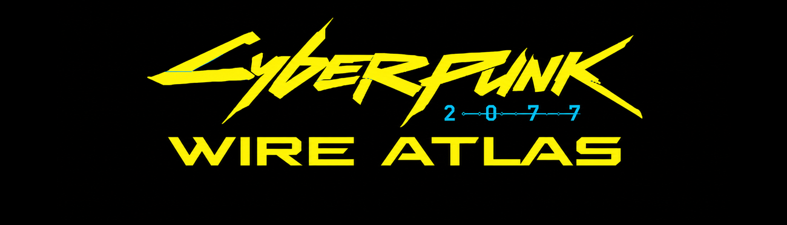
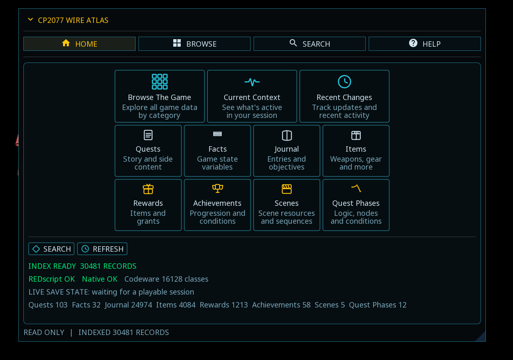
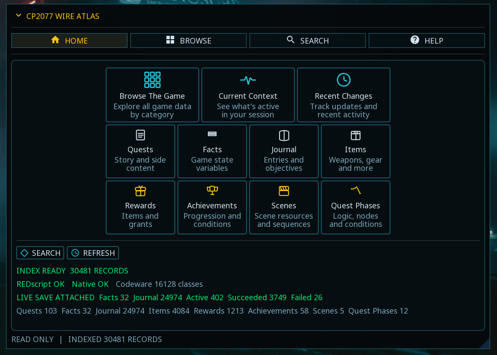
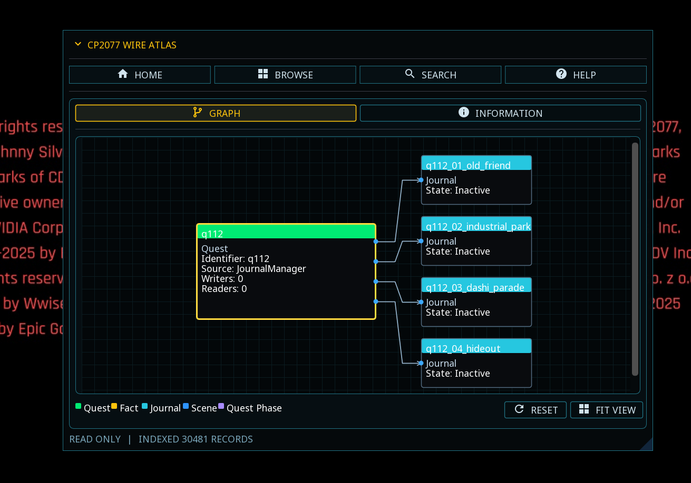
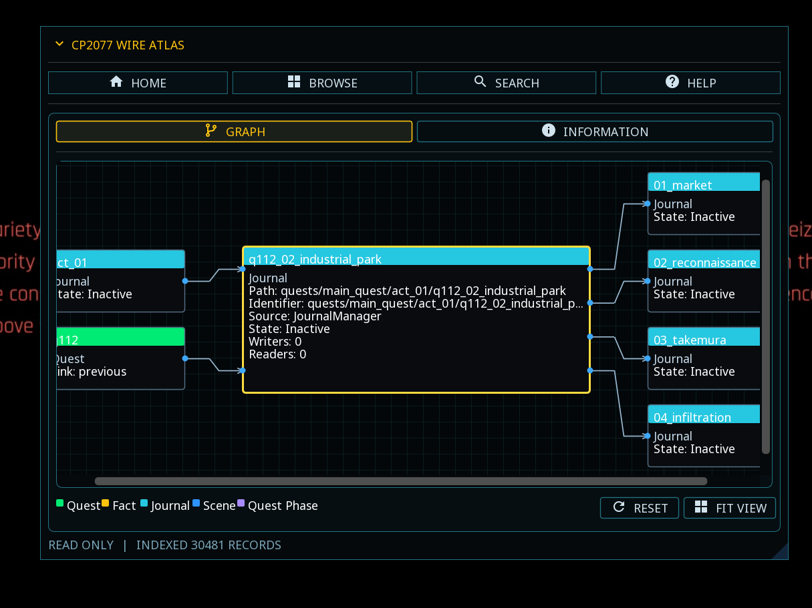

<div align="center">



# CP2077 Wire Atlas

**A read-only Cyberpunk 2077 one-hop logic inspector for exploring game records and their relationships.**


</div>

---

CP2077 Wire Atlas is a read-only, in-game inspector for Cyberpunk 2077's indexed quests, facts, journal entries, items, rewards, achievements, scenes, and quest phases.

Its **one-hop relationship graph** shows the selected record in the center, incoming relationships on the left, and outgoing relationships on the right. Follow an indexed connection to examine the next record without turning the entire quest into an unreadable network.

Wire Atlas combines information available through the game's runtime systems with documented research references. It distinguishes known writers and readers from journal hierarchy and identifier-based associations; a visible connection is not necessarily proof of execution order.

---

## Features

- Home dashboard with index status, category counts, component diagnostics, and live-save information
- Eight indexed collections: Quests, Facts, Journal, Items, Rewards, Achievements, Scenes, and Quest Phases
- Browse by category, view all indexed records, or revisit recently opened records
- Search across record identifiers, names, paths, and available source information
- Direct fact lookup through the game's quest system
- Record Inspector with Overview, Relationships, and Raw Data views
- Writers / Readers reference for documented game-state operations
- **One-hop relationship graph** with directional connections, record metadata, and color-coded node types
- Navigate between connected records to inspect their immediate relationships
- RESET, FIT VIEW, and an inline graph legend
- In-app Help and detailed Graph Information pages
- Index refresh and supported live fact/journal state updates when a playable save is attached
- Read-only: no intentional changes to quests, facts, inventory, achievements, or saved games

---

## Screenshots

### Home — Index Overview



### Home — Live Save Attached



### One-Hop Quest Graph



### Journal Relationship Inspection



---

## Installation

Install the release ZIP with **Vortex**, or extract its contents directly into the Cyberpunk 2077 game directory while preserving the included folder structure.

The archive installs files under:

```text
Cyberpunk 2077\bin\x64\plugins\cyber_engine_tweaks\mods\CP2077 Wire Atlas\
Cyberpunk 2077\r6\scripts\CP2077 Wire Atlas\
Cyberpunk 2077\red4ext\plugins\CP2077 Wire Atlas\
```

Do not place the entire ZIP as a single folder inside the CET mods directory; its contents span multiple game directories.

---

## Usage

Launch Cyberpunk 2077 and open the CET overlay to access Wire Atlas.

**HOME** displays the indexed collections, system diagnostics, and live-save statistics. Use **REFRESH** to rebuild the available index.

**BROWSE** provides Categories, All Items, and Recent, plus shortcuts to specialized inspection tools.

**SEARCH** locates indexed records and allows direct fact lookups.

**RECORD INSPECTOR** shows a selected record's Overview, Relationships, and Raw Data.

**RELATIONSHIP GRAPH** shows the selected record and its immediate incoming and outgoing connections. Select an indexed neighboring record to continue the investigation one hop at a time. The **INFORMATION** tab explains graph behavior, relationship types, and limitations in detail.

A playable save is needed for supported live fact and journal state information; the static index can also be built at the main menu.

---

## Understanding the One-Hop Graph

The center node is the current record. Incoming connections appear on the left; outgoing connections appear on the right. The graph focuses on directly indexed relationships instead of automatically expanding every connected record.

Node colors distinguish record types, and wires identify the available relationship classification. Writers and readers are documented references; journal parent/child links describe hierarchy; shared quest identifiers indicate associations. These are different kinds of evidence.

A missing connection means Wire Atlas has no supported connection to display in the current index. It does **not** prove that the underlying game contains no such relationship.

The graph is an inspection tool, not a full quest execution tracer. See the in-app **HELP** and **GRAPH → INFORMATION** pages for the complete reference.

---

## Requirements

- Cyberpunk 2077
- Cyber Engine Tweaks (CET)
- RED4ext
- REDscript
- Codeware for the included reflection bridge functionality

---

## Compatibility

Developed and tested with **Cyberpunk 2077 2.31**.

Wire Atlas reads available runtime game data and includes researched relationship references. Coverage is limited by what the installed game and included research index expose; indexed counts are not game-completion statistics.

The app does not continuously trace every state transition or automatically reconstruct complete quest execution paths.

---

## Read-Only Operation

Wire Atlas is intended for inspection and research. It does not intentionally:

- Set or reset quest facts
- Complete or fail quests
- Change journal states
- Add or remove items or rewards
- Unlock achievements
- Modify saved-game data

---

## Credits

Created by **Big2What**.

Developed as a standalone Cyberpunk 2077 research and mod-development utility.

**Version 0.3.39**
